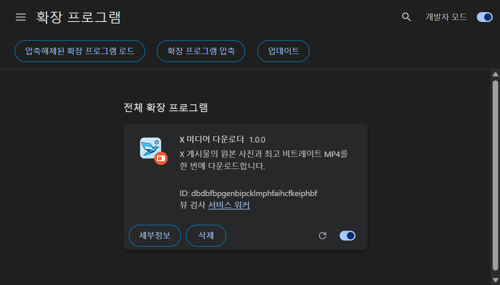
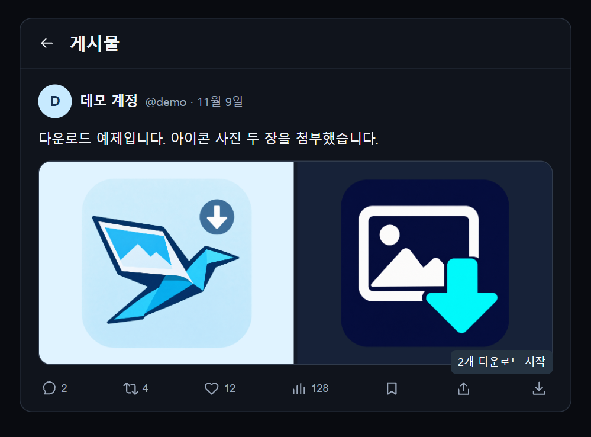

# X 미디어 다운로더


X(Twitter) 게시물에 첨부된 사진, 동영상, GIF를 한 번에 저장하는 Chrome 확장 프로그램입니다. 타임라인과 게시물 상세 화면에서 공유 아이콘 옆에 다운로드 버튼이 표시됩니다.

## 설치

**Chrome 111 이상**이 필요합니다.

1. 이 저장소의 **Code → Download ZIP**으로 파일을 받은 뒤 압축을 풉니다. Git을 사용한다면 저장소를 복제해도 됩니다.
2. Chrome 주소창에 `chrome://extensions`를 입력하고 오른쪽 위의 **개발자 모드**를 켭니다.
3. **압축해제된 확장 프로그램 로드**를 눌러 저장소 안의 `extension` 폴더를 선택합니다. 이 폴더에 `manifest.json`이 있습니다.
4. 확장 프로그램 목록에서 **X 미디어 다운로더**가 켜져 있는지 확인하고, 열려 있는 X 탭을 새로고침합니다.



## 사용법

1. `x.com` 또는 `twitter.com`에서 미디어가 첨부된 게시물을 엽니다. 타임라인에서 바로 받을 수도 있습니다.
2. 게시물 아래 공유 버튼 옆의 **다운로드 아이콘(↓)**을 한 번 누릅니다.
3. Chrome 다운로드 목록에서 개별 파일을 확인합니다. 인용된 게시물의 미디어를 받으려면 그 게시물을 열고 같은 절차를 따릅니다.



*설치 화면은 분리된 Chromium 프로필에서, 다운로드 화면은 같은 환경의 로컬 예제 게시물에서 캡처했습니다.*

### 화질과 저장 위치

| 미디어 | 저장 품질 |
| --- | --- |
| 사진 | X가 제공하는 원본 크기(`name=orig`) |
| 동영상과 GIF | X가 제공하는 MP4 중 비트레이트가 가장 높은 파일 |

파일은 Chrome에 설정된 다운로드 폴더 바로 아래에 `<게시물 ID>-<번호>.<확장자>` 형식으로 저장됩니다. Windows에서 Chrome 기본 위치를 쓰면 `C:\Users\<사용자>\Downloads`에 저장되며, 현재 위치는 `chrome://settings/downloads`에서 확인할 수 있습니다.

## 문제 해결

- **다운로드 버튼이 보이지 않아요.** 확장 프로그램이 켜져 있는지 확인한 뒤 X 탭을 새로고침합니다. 버튼은 첨부 미디어가 있는 게시물에 표시됩니다.
- **동영상 주소를 찾지 못했어요.** 게시물 상세 화면을 새로고침하고 다시 시도합니다. X가 HLS 스트리밍 주소만 제공하는 영상은 지원하지 않습니다.
- **파일이 어디에 저장됐는지 모르겠어요.** `chrome://downloads`에서 해당 파일의 **폴더에 표시**를 선택합니다.

## 권한

확장 프로그램은 X 페이지가 받은 응답과 화면에서 첨부 미디어 주소를 찾습니다. Chrome의 `downloads` 권한으로 X의 미디어 서버에서 파일을 직접 저장합니다.

## 개발

`extension/`에 확장 프로그램이, `tests/`에 미디어 선택과 다운로드 요청을 확인하는 테스트가 있습니다. 저장소 루트에서 Node.js의 내장 테스트 러너를 실행합니다.

```sh
node --test
```

## 라이선스

[MIT](LICENSE)
